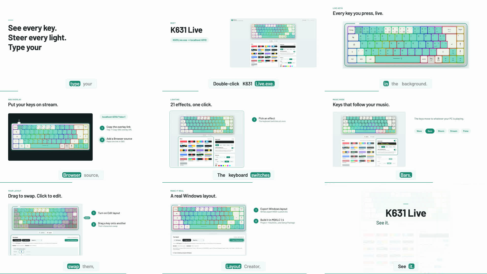

# K631 Live

Shows every key pressed on the Redragon K631 on the AZERTY 68-key layout, live,
even while the page is in the background. It also drives the keyboard's lighting, adds a music mode and lets
you design your own Windows keyboard layout.

## Demo

[](demo/video.mp4)

▶ **[Watch the demo video](demo/video.mp4)** (MP4, ~24 MB): live keys, the OBS overlay, lighting effects,
music mode and the layout editor.

There's also an interactive demo that runs in the browser with a simulated keyboard:
open `demo/k631-live-demo.html`.

## Run

Double-click `K631Live.exe`. It opens http://localhost:6310/ and sits in the tray.

| Tray menu | Does |
|---|---|
| Open K631 Live | Opens the page |
| Copy OBS overlay URL | Copies `http://localhost:6310/?obs=1` (keyboard only, transparent background) |
| Show keys from all keyboards | Also shows presses from other keyboards |
| Quit | Stops it |

Command-line flags: `--all` (start with all keyboards), `--no-browser` (don't open the page).

For OBS: add a **Browser** source, paste the overlay URL, and set the width to about 1000 px.

## How it works

- `src/K631Live.cs` registers for Windows Raw Input, so it receives key presses in the background.
  It keeps only those whose device path contains `VID_258A&PID_0049`, the IDs found in the Redragon
  driver's `Cfg.ini`.
- Scan codes are converted to `KeyboardEvent.code` names and streamed to the page as Server-Sent Events (`/events`).
- `web/index.html` is the layout page. It lights the matching key. Fn-layer codes (F1–F12, Home, End,
  Insert, PrintScreen, media keys) light the physical key plus **Fn**. The Fn key alone never reaches the PC.

## Lighting

The **Lighting** panel sets the effect (1–21), brightness (0–4) and speed (1–4), and applies them immediately.

- It uses only the protocol captured from the official app (`../K631-protocol-notes.md`). It reads block C6,
  changes the effect byte and that effect's speed/brightness byte, and writes it back. It refuses to write if the
  block doesn't look as expected or more than those two bytes would change.
- It does nothing while the Redragon app (`KeyboardDrv.exe`) is running. Close that app first, including from the tray.
- The first change in each session saves the original block to `backup\C6-<time>.bin`.
- Colour and per-key colours are not supported yet; they're waiting for the colour capture.

## Music mode

The **Music mode** switch (Lighting tab) listens to whatever the PC is playing, using Windows loopback capture of
the default output device, and lights the keyboard in one of the Redragon app's 5 music styles:
**Wave** (a line riding the levels), **Bars** (equalizer), **Bloom** (from the centre), **Stream** (from the left)
and **Pulse** (the whole board, new colour on each beat).

- K631Live.exe renders each frame (~25 per second) and sends it to the keyboard as the same live 382-byte report
  the Redragon app uses (report 8, COL08). The page shows the identical frame, so the preview matches the real keys.
  This keeps working when the page is minimised.
- **Light the keyboard too** off = preview only. Then the keyboard's own effect is switched off (brightness 0)
  while music plays and restored afterwards, so music and an effect never show at once.
- Stopping music mode, or clicking any effect, hands the keyboard back to its effect.
- Only frequency levels are used; no audio is recorded or saved. It stops by itself 5 seconds after the last
  K631 Live page or overlay closes, and it won't stream while the Redragon app is running.

## Layout

The **Layout** panel lets you design your own layout and turn it into a real Windows keyboard layout.

- **Edit layout**: drag a key onto another to swap what they type, or click a key to set its **Normal**, **Shift** and
  **Alt Gr** characters. Tick **Accent key** for `^ ¨ ~ \` ´` to make them combine with the next letter (ê, ñ…).
- **Reset to…**: *AZERTY, digits first* (number row types 1–0, the AZERTY symbols move to Shift, Alt Gr unchanged)
  or plain *AZERTY (Windows)*.
- The layout is saved in `state\layout.json`.
- **Export Windows layout** writes `export\K631-custom.klc`.

Only character keys can be moved; Ctrl, Shift, Alt, arrows etc. stay where they are. The keyboard's own key map is
never changed: the layout lives in Windows, so it applies to any keyboard while it's selected.

### Install the exported layout (once per change)

1. Install **Microsoft Keyboard Layout Creator 1.4** (free, from Microsoft). It needs .NET Framework 3.5
   (Windows Features → ".NET Framework 3.5").
2. In MSKLC: **File → Load Source File** → `export\K631-custom.klc`, then **Project → Build DLL and Setup Package**.
3. Run `setup.exe` from the folder it creates (normally `Documents\K631AZ`).
4. Settings → Time & language → Language & region → French → Keyboard → add **French - K631 custom**.
   Switch layouts with **Win + Space**.

To update it later: uninstall *French - K631 custom* (Settings → Apps), export again, rebuild and reinstall.

## Privacy

The server listens on 127.0.0.1 only and rejects requests addressed to any other host name,
which blocks DNS-rebinding pages. Nothing is written to disk. Quit it from the tray when you don't need it.

## Build

```
powershell -ExecutionPolicy Bypass -File build.ps1
```

This uses the C# compiler included with Windows, so no SDK is needed.

To rebuild the interactive demo after changing `web/index.html`:

```
powershell -ExecutionPolicy Bypass -File demo/build-demo.ps1
```
